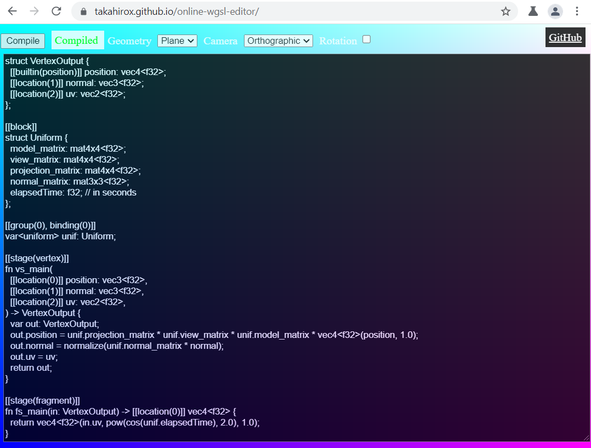

# online-wgsl-editor

`online-wgsl-editor` is a tiny online [WGSL (WebGPU Shading language)](https://www.w3.org/TR/WGSL/) editor.

You can test WGSL on your web browser. It is good especially for people who want to learn WGSL.

## Demo

[Online demo](https://takahirox.github.io/online-wgsl-editor/index.html)

Use Chrome for the Demo. It doesn't run on FireFox and other browsers yet.

## Presentation

[WebGL + WebGPU Meetup - January 2022](https://www.khronos.org/events/webgl-webgpu-meetup-january-2022) / [Slides](https://docs.google.com/presentation/d/1WP5YGAoYvFnj2JYinV7r7SNA8sKngfW2ZNaeyIDiIy8)

## Screenshots



## How to run locally

```sh
$ git clone https://github.com/takahirox/online-wgsl-editor.git
$ cd online-wgsl-editor
$ npm install
$ npm run start
# Access http://localhost:8080 on your web browser
```

Note: To run the demo locally, download [Google Chrome Canary](https://www.google.com/chrome/canary/) and enable `#enable-unsafe-webgpu` flag via `chrome://flags`.

## UI/UX

Apply these principles to the editor's layout, shader editing, geometry/camera/rotation
controls, and compilation status and error feedback:

1. **Keep it simple.** Show only necessary information and actions; avoid unnecessary UI elements.
2. **Show, don't tell.** Prefer layout, spacing and visual hierarchy over explanatory labels or prose to communicate structure.
3. **Intuitive and predictable.** Keep appearance and behavior consistent with user expectations; don't interrupt the user's work.

Preserve necessary control labels, accessible names, error messages, and information
needed to use the interface. Simplification must preserve meaningful consent,
destructive-action safeguards, necessary warnings, and necessary user decisions.

## Contributing

Use English for new collaboration content. See the [development flow](docs/development-flow.md)
for Issue authoring, implementation, validation, and PRs, and the
[review and merge guidelines](docs/review-guidelines.md) for reviewing contributions.
AI agents should start with [AGENTS.md](AGENTS.md).

## Thanks to

I referred to [Three.js](https://threejs.org/) and [glMatrix](https://glmatrix.net/) for WebGPU and Math.
